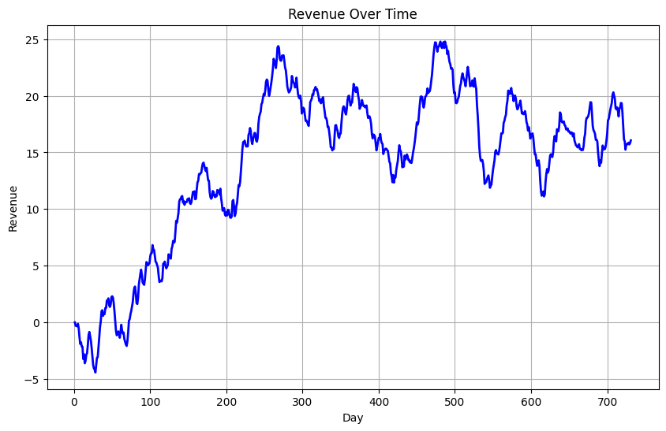

# Forecasting daily changes in hospital revenue

I used 731 daily hospital revenue observations to evaluate ARIMA forecasts for hospital finance staff. The primary evaluation issued **146 forecasts together** from day 585. ARIMA had RMSE **0.4887 million dollars** of daily revenue change, versus **0.4860 million** for assuming no change. I also projected revenue levels for the next 30 days.

*Observed daily hospital revenue over 731 days, in millions of dollars.*

[Open the forecast notebook](notebooks/revenue_arima_forecast.ipynb) · [Inspect the 731-day source series](data/hospital_revenue_raw.csv) · [View the revenue history](assets/report-extracts/)

## What was evaluated

The accompanying data dictionary reports revenue in millions of dollars. The CSV contains days 1–731. First differencing produced 730 day-to-day changes. I fitted an AR(1) model to the first 584 changes and issued all 146 test forecasts from day 585. The first prediction corresponds to day 586 and the last to day 731.

| Forecast on the 146 test days | Mean absolute error (millions of dollars) | Root mean squared error (millions of dollars) |
|---|---:|---:|
| ARIMA on daily changes | 0.3765 | 0.4887 |
| Assume no daily change | 0.3746 | 0.4860 |

## Model and 30-day forecast

The Augmented Dickey–Fuller test gave a p-value of 0.1997 on levels and about 5.11 × 10⁻³⁰ after differencing. The exploratory correlation plots informed the choice of one autoregressive lag. The holdout model is `ARIMA(1,0,0)` on daily changes.

For a forecast issued after day 731, the notebook refits that model form to all 731 revenue levels as `ARIMA(1,1,0)` with drift. It projects days **732–761** and calculates 95% prediction intervals directly on revenue levels. I cannot score those future predictions because this dataset has no observed revenue for those dates.

## Additional comparison: forecasts updated each day

A separate daily evaluation refits the same AR(1) model form on an expanding history before predicting the next day. Each new fit sees only observations available before its forecast. The test dates remain days 586–731.

| Forecast cadence | MAE ($ millions of daily change) | RMSE ($ millions of daily change) |
|---|---:|---:|
| ARIMA, refitted before each next day | 0.3531 | 0.4408 |
| Assume no daily change | 0.3746 | 0.4860 |

Daily operations and a budget prepared months in advance have different information available. These results support ARIMA for the tested daily update schedule, while the fixed-origin comparison favors no change. I evaluated daily changes, so these scores do not measure error in monthly totals. [All 146 paired forecasts](data/forecast_evaluation.csv)

## Run it yourself

The evaluation used Python 3.13.1, statsmodels 0.14.4 and NumPy 2.2.2. [Numerical environment](requirements-verified.txt)

Install the [Python requirements](requirements.txt) in a Jupyter environment and run the notebook with `notebooks/` as the working directory. The prepared series are included. [Training changes](data/train_dataset.csv) · [Holdout changes](data/test_dataset.csv) · [Cleaned series](data/cleaned_dataset.csv)

## Data and environment

Data: WGU daily hospital-revenue series; [source notes](data/README.md).  
Install: `python -m pip install -r requirements.txt`; [environment details](requirements-verified.txt).

*WGU M.S. in Data Analytics coursework, D603 Machine Learning.*
